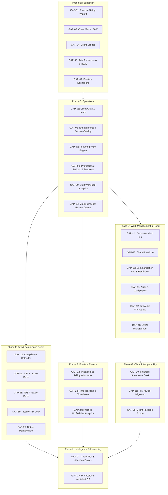

# TAXSHIELD PROFESSIONAL: CA & ACCOUNTANT GAP MATRIX

**Document Version:** 1.0  
**Status:** Approved for Implementation  
**Target Architecture:** Multi-Client Practice Operating System for Indian Chartered Accountants & Accounting Firms  

---

## 1. Feature Gap Matrix Overview

The following matrix documents every capability required to transform TaxShield into **TaxShield Professional**, detailing the business justification, professional user benefit, implementation specification, priority, dependencies, and automated acceptance criteria.

---

## 2. Comprehensive Practice Management Gap Matrix

| # | Feature / Capability | Priority | Business Reason | Professional User Benefit | Implementation Requirement | Dependencies | Acceptance Test |
|---|---|---|---|---|---|---|---|
| **GAP-01** | **Practice Setup Wizard** | **P0** | CAs have firm structures, registration details, and staff roles that differ fundamentally from small business owners. | Sets up firm branding, partner/manager/staff hierarchies, services offered, and compliance calendars in 5 minutes. | Multi-step wizard: Practice Info -> Professional Profile -> Practice Structure -> Services Catalog -> Workflow Preferences -> Client Import. Persisted in `practice_profiles` collection. | Auth, User model | Complete wizard saves to backend; `/api/practice/profile` returns full firm profile with partners, staff, and services. |
| **GAP-02** | **Practice Dashboard & Attention Center** | **P0** | Partners waste hours daily checking Excel sheets and WhatsApp to know what is urgent across 100+ clients. | Single screen answering "What is happening in my practice today?": urgent client matters, pending reviews, overdue tasks, approaching statutory deadlines, uncollected fees. | New dashboard aggregation endpoint `GET /api/practice/dashboard` returning real-time metrics, attention list, staff workload summary, and compliance countdowns. | Practice profile, Client master, Tasks | Dashboard renders real metrics; filtering by staff, client, service, and urgency updates view instantaneously. |
| **GAP-03** | **Client Master 360° Profile** | **P0** | Current system only stores a client's name. Professional practices need comprehensive entity intelligence. | Centralized repository for PAN, TAN, GSTIN, CIN/LLPIN, entity constitution (LLP, Pvt Ltd, Proprietorship, Trust, etc.), assigned CA/accountant, client groups, tags, and 360° workspace tabs. | Enhanced `clients` collection with statutory fields, group links, tags, and tabs (Overview, Profile, Services, Engagements, Transactions, Accounting, GST, TDS, ITR, Audit, Documents, Workpapers, Tasks, Notices, Fees, Activity History). | Tenancy, Database | CRUD operations on clients with full entity validations; client 360° profile loads all client-specific records. |
| **GAP-04** | **Client Groups & Multi-Entity Management** | **P1** | Business promoters own multiple entities (parent, subsidiaries, LLP, proprietor firms) managed by the same CA. | View and manage related entities together under one promoter group while maintaining strict data isolation between distinct legal entities. | `client_groups` collection linking multiple client IDs to a parent group with consolidated compliance tracking. | Client Master | Grouping clients shows consolidated group overview; transactions remain isolated to legal entity. |
| **GAP-05** | **Client CRM & Lead Management** | **P1** | CA firms lose prospective revenue due to unstructured lead tracking across emails and phone calls. | Visual pipeline (New Lead -> Contacted -> Discussion -> Proposal Sent -> Negotiation -> Accepted -> Client Created) with expected fees, services, and follow-up dates. | `leads` collection with status transitions, quotation generation, notes, follow-up scheduler, and one-click conversion to active client. | Practice profile, Service catalog | Lead progresses through pipeline stages; accepting lead creates verified client and initial engagement. |
| **GAP-06** | **Engagement Management & Service Catalog** | **P0** | A single client contracts multiple distinct services (Monthly GST, Quarterly TDS, Annual Audit, ITR) with different fees and assignees. | Clear contractual scopes, deliverable schedules, assigned partners/managers/accountants, agreed professional fees, and engagement statuses. | `engagements` and `services` collections. Editable service catalog (Accounting, GST, TDS, ITR, Audit, MCA). Engagement templates with automatic task linking. | Client Master | Create engagement links service, client, staff, and generates associated workflow tasks. |
| **GAP-07** | **Recurring Compliance Workflow Engine** | **P0** | Manually creating recurring compliance tasks for 100+ clients every month is error-prone and causes missed deadlines. | Automatically generates monthly/quarterly tasks (GSTR-1, GSTR-3B, TDS 26Q/24Q, Advance Tax) for applicable clients based on verified statutory rules. | Recurring workflow generator engine running against compliance calendar; checks client GST/TDS applicability; generates tasks with deadlines and assignments. | Engagements, Tasks | Triggering workflow generator for month creates tasks only for applicable clients with correct deadlines. |
| **GAP-08** | **Professional Task Management (12 Statuses)** | **P0** | Standard to-do lists cannot handle multi-stage accounting workflows involving client evidence and partner approvals. | Strict 12-stage workflow (`NOT_STARTED` -> `AWAITING_CLIENT` -> `DOCUMENTS_RECEIVED` -> `IN_PROGRESS` -> `PREPARED` -> `UNDER_REVIEW` -> `REVIEW_NOTES_RAISED` -> `REWORK` -> `APPROVED` -> `COMPLETED` -> `ON_HOLD` -> `CANCELLED`) with checklists and effort tracking. | State machine enforcing valid transitions; checklists, dependencies, attachments, estimated vs actual hours, and bulk task operations. | Engagements, Staff | Transitioning invalid task status rejected with 422; valid transitions update timeline and notify assignees. |
| **GAP-09** | **Staff & Team Management with Workload Analytics** | **P1** | Partners need visibility into who is overloaded and who has capacity to meet upcoming statutory deadlines. | Team profiles (Partner, Manager, Senior Accountant, Junior Accountant, Audit Staff), client assignments, open task counts, overdue counts, and workload-aware task distribution. | `team_members` collection, role permissions, workload aggregation endpoint `GET /api/practice/team/workload`. | Auth, Roles | Workload dashboard displays real-time task distribution; assigning task recalculates workload. |
| **GAP-10** | **Maker-Checker & Review System** | **P0** | Fundamental to professional quality control (ICAI SQC-1): work prepared by staff must be independently reviewed and approved. | Structured review queue where managers/partners review prepared work, raise tagged annotations/correction notes, return for rework, or grant final sign-off. Self-approval prevented. | `reviews` collection supporting comments, version diffs, reviewer identity stamps, and enforcement of independent review rules. | Tasks, Auth | Accountant cannot approve own work if policy requires partner sign-off; review notes trigger rework state. |
| **GAP-11** | **Audit & Workpaper Management System** | **P1** | CA audit engagements require structured working papers to comply with ICAI Standards on Auditing (SA 230). | Organizes workpapers hierarchically (Client -> Engagement -> FY -> Audit Type -> Section -> Workpapers), with lead schedules, evidence links, conclusions, and reviewer sign-off. | `workpapers` collection with audit programmes, checklists, management representations, balance confirmations, and completeness verification. | Engagements, Documents | Creating workpaper links to trial balance line item; reviewer sign-off updates audit completeness score. |
| **GAP-12** | **Tax Audit Workspace (Form 3CD Tracker)** | **P1** | Tax audits under Section 44AB require rigorous observation tracking and schedule verification. | Dedicated workspace to track trial balance adjustments, Clause-by-Clause Form 3CD observations, evidence attachments, signing partner, and UDIN reference. | `tax_audits` collection with 3CD clause checklist, adjustment journals, audit observations, and delivery lifecycle. | Accounting engine, Workpapers | Tax audit workflow tracks prepared -> reviewed -> approved -> signed -> delivered statuses with audit log. |
| **GAP-13** | **UDIN Management (ICAI Compliant)** | **P1** | Practicing CAs must generate and record Unique Document Identification Numbers (UDIN) for all certificates and audit reports. | Securely record, validate format (18 digits), and link official ICAI UDINs to issued reports, certificates, and tax audits without claiming fake automation. | `udin_records` collection with signing CA membership number, document date, generation date, verification status, and linked engagement. | Engagements, Audit | Saving UDIN validates 18-digit ICAI checksum pattern and links to certificate; prevents duplicate UDIN reuse. |
| **GAP-14** | **Document Management 2.0 & Secure Vault** | **P0** | Client documents are currently scattered in WhatsApp chats and unorganized file shares. | Client-wise and year-wise structured folder taxonomy (`FY` -> `GST`, `TDS`, `Income Tax`, `Audit`, `Banking`, `Financials`), versioning, and missing document checklist intelligence. | `document_vault` collection, metadata tagging, checksum verification, client request status, and automatic missing evidence detection. | Client Master, Storage | Missing document intelligence compares client obligations against uploaded documents and flags gaps. |
| **GAP-15** | **Client Portal 2.0 (Mobile-First)** | **P0** | Clients constantly interrupt CA staff asking about return status, pending documents, and tax calculations. | Self-service client portal where clients view assigned accountant, upload requested documents, check compliance status, view authorized tax summaries, and pay fees. | Dedicated client view role (`Role.CLIENT`), authenticated endpoints scoping data strictly to client entity, hiding internal practice notes and workpapers. | Auth, Client Master | Client signs in and sees only authorized reports and document requests; cannot access other clients or internal review notes. |
| **GAP-16** | **Client Communication Hub & Follow-up Automation** | **P1** | Staff spend hours chasing clients for bank statements, GST invoices, and tax approvals. | Unified communication timeline (logged emails, calls, meetings, messages) with one-click WhatsApp sharing templates and automated pending document reminders. | `communication_logs` collection, message templates (GST reminder, TDS reminder, fee reminder), browser-native WhatsApp Web integration (no paid API). | Client Master, Tasks | Triggering WhatsApp share generates properly encoded URL with pre-filled professional reminder text. |
| **GAP-17** | **GST Professional Desk (Practice-Wide)** | **P0** | Currently GST is single-client. A CA firm needs to see the filing and reconciliation status of 100+ clients at a glance. | Portfolio dashboard showing GSTR-1 & GSTR-3B filing readiness across all clients, Books vs GSTR-2B 8-way reconciliation, ITC exceptions, and IMS review. | `GET /api/practice/gst/portfolio` aggregation, 8-way matching engine (`MATCHED`, `MISSING_IN_BOOKS`, `MISSING_IN_PORTAL_DATA`, `VALUE_MISMATCH`, etc.). | GST engine, Client Master | GST desk lists all GST-applicable clients with filing status; running 2B reconciliation classifies discrepancies. |
| **GAP-18** | **TDS Professional Desk (Practice-Wide)** | **P0** | CAs handle quarterly TDS compliance (24Q/26Q) for multiple businesses simultaneously. | All-client TDS portfolio tracking deductee records, monthly deduction vs deposit, challan verification, return preparation status, and Form 16/16A generation checklist. | `GET /api/practice/tds/portfolio` aggregation, quarterly 24Q/26Q readiness checklist, and challan reconciliation. | TDS engine, Client Master | TDS desk displays all TDS-liable clients with quarter status; highlights unmapped challans and short deductions. |
| **GAP-19** | **Income Tax Professional Desk (Client Portfolio)** | **P0** | Tax season requires tracking hundreds of individual and corporate ITR filings simultaneously. | Portfolio tracking ITR applicability (ITR-1 through ITR-7), client document collection, AIS/26AS batch comparison, regime comparison, computation sign-off, and filing acknowledgement. | `GET /api/practice/tax/portfolio` aggregation, return-readiness checklist, and structured JSON export conforming to official e-filing schemas. | Tax engine, AIS/26AS | Tax desk lists clients with computation status; AIS reconciliation flags unmatched interest/dividends. |
| **GAP-20** | **Financial Statement Preparation Desk** | **P1** | Finalizing year-end accounts requires trial balance mapping, adjustment journals, and statutory schedule formatting. | Professional workspace to import trial balance, map accounts to Schedule III balance sheet / P&L formats, post closing/adjustment entries, and generate comparative statements. | `GET /api/practice/financial-statements` endpoints, chart-of-accounts mapping engine, adjustment journal posting, and multi-year comparative views. | Accounting engine | Mapping imported trial balance generates balanced balance sheet and P&L reconciling to underlying ledger. |
| **GAP-21** | **Tally / Excel Migration & Interoperability** | **P1** | Accountants maintain existing data in Tally ERP/Prime or Excel and refuse systems that require manual re-entry. | Universal import wizard: CSV/Excel upload -> intelligent column mapping -> validation -> duplicate check -> preview -> confirmed import -> error report. | Reusable migration service handling Chart of Accounts, Masters (Customers/Vendors), Journals, and Trial Balances with error row isolation. | Accounting engine | Uploading Excel trial balance maps columns; valid rows imported; invalid rows exported with error reasons. |
| **GAP-22** | **Practice Fee Management & Client Billing** | **P0** | CA firms need to bill their clients for professional services and track receivables independently from client accounts. | Professional fee agreements, engagement invoicing, credit notes, receipts, outstanding fee ageing (0-30, 31-60, 61-90, 90+ days), and client-wise collection tracking. | `practice_invoices`, `practice_receipts`, `fee_agreements` collections. Strict isolation between practice revenue and client bookkeeping. | Invoicing, Client Master | Generating practice invoice updates practice receivables without affecting client's own books of accounts. |
| **GAP-23** | **Time Tracking & Staff Utilisation** | **P2** | Multi-partner firms need to know whether fixed-fee engagements are profitable based on actual staff hours. | Optional timesheet logging (client, engagement, service, billable vs non-billable hours, work notes) and staff utilisation analytics without intrusive employee surveillance. | `timesheets` collection, billable rate calculations, engagement cost tracking, and staff utilisation reports. | Team management, Engagements | Logging timesheet calculates engagement labor cost; compares against billed fee to report margin. |
| **GAP-24** | **Practice Profitability Analytics** | **P1** | Partners need to identify which services and clients generate the highest profit margins. | Analytics dashboard showing revenue by service, revenue by client, outstanding fees by client, recovery rates, team turnaround time, and client retention. | Aggregation pipeline calculating practice financial KPIs, service profitability, and staff efficiency metrics. | Practice Finance, Timesheets | Practice profitability report displays margin per engagement and service category. |
| **GAP-25** | **Notice Management & Case Tracker** | **P1** | Statutory notices (Income Tax 142(1), 143(2), 148, GST DRC-01, ASMT-10) require deadline monitoring and legal response review. | Centralized case repository tracking authority, notice number, section, issue summary, response deadline, assigned CA, response draft, review notes, and closure status. | `statutory_notices` collection with authority classification, statutory deadline countdown, document attachments, and legal review sign-off. | Client Master, Tasks | Adding notice schedules deadline alert in calendar; closing notice requires partner review sign-off. |
| **GAP-26** | **Professional Compliance Calendar** | **P0** | Statutory deadlines for GST, TDS, Advance Tax, ITR, and ROC must be tracked across the entire client portfolio. | Practice-wide calendar with Day, Week, Month, and Quarter views, filtering by service, client, staff member, and completion status. | `compliance_calendar` engine mapping Indian statutory due dates (11th, 20th, 7th, 15th, 31st July, 31st Oct, etc.) to active client services. | Deadlines, Client Master | Calendar highlights upcoming deadlines; clicking event opens associated client tasks. |
| **GAP-27** | **Client Risk & Attention Engine** | **P0** | High-risk clients with impending deadlines or missing documents must be flagged proactively to avoid penalties. | Deterministic rule-based risk score (0-100) and Attention Center displaying root causes (missing documents, reconciliation mismatches, overdue tasks, unreviewed returns). | Rule-based risk evaluation service computing health scores based on verifiable operational discrepancies. | Intelligence, Reconciliation | Client with 2 overdue tasks and missing bank statement automatically receives "HIGH RISK" attention badge. |
| **GAP-28** | **Client Package Export (Dossier Handover)** | **P1** | When completing an audit or handing over client accounts, the firm must export the complete client dossier. | Generates client-wise ZIP archive containing profile, ledgers, trial balance, financial statements, GST/TDS summaries, documents index, and audit trail with SHA-256 checksum manifest. | Zip generation service bundling CSVs, JSON records, PDF reports, and manifest without exposing internal partner notes. | Backup engine, Client Master | Exporting package produces valid ZIP file with verification manifest; internal notes excluded. |
| **GAP-29** | **Professional Practice Assistant 2.0** | **P1** | CAs need voice or chat queries to immediately inspect practice operations without clicking through multiple menus. | Assistant understands practice queries: "Which clients have GST pending?", "Show staff workload", "Which engagements need partner approval?", "Show overdue practice fees". | Enhanced intent classification and tool execution in `chat.py` pulling authorized practice aggregation data. | Assistant, Practice Dashboard | Asking "Which clients have GST pending?" returns real list of clients with incomplete GSTR-1/3B. |
| **GAP-30** | **Role-Based Workspaces & Personalization** | **P0** | Different professionals (Solo CA, Managing Partner, Staff Accountant, Tax Specialist, Audit Staff, Client) need tailored workspaces. | Personalized navigation, dashboard, and permissions tailored to user role, preventing clutter and securing sensitive partner data. | RBAC permission matrix in `tenancy.py` and dynamic sidebar/dashboard rendering based on active role. | Auth, Tenancy | Staff accountant views only assigned clients and tasks; partner views full practice financials and review queue. |

---

## 3. Implementation Phasing & Dependency Graph

---

## 4. Acceptance Criteria & Certification Standard
Every gap listed above will be implemented with:
1. Pure Python deterministic backend models and endpoints.
2. MongoDB collections with proper multi-tenant and practice indexing.
3. Fully-typed TypeScript frontend App Router pages and components.
4. Comprehensive automated unit and integration tests passing cleanly.
5. Absolute zero paid dependencies — 100% buildable and runnable locally.

