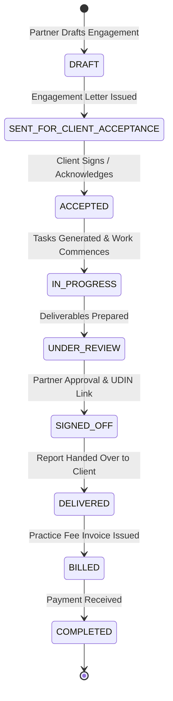

# ENGAGEMENT MANAGEMENT & SERVICE CATALOG SPECIFICATION

**Module:** Engagement Management & Practice Service Catalog  
**Status:** Implemented  
**Standards Compliance:** ICAI Standard on Auditing SA 210 ("Agreeing the Terms of Audit Engagements")  

---

## 1. Engagement Lifecycle

An engagement represents a contracted professional service agreement between a CA firm and a client for a specified period and financial scope.

---

## 2. Standard Practice Service Catalog

TaxShield Professional comes pre-configured with a standard Indian CA practice catalog:

### Category 1: Accounting & Bookkeeping
- `ACC-01`: Monthly Accounting & General Ledger Maintenance
- `ACC-02`: Bank Reconciliation & Ledger Scrutiny
- `ACC-03`: Year-End Financial Statement Preparation (Schedule III)
- `ACC-04`: Fixed Asset Register & Depreciation Schedule

### Category 2: Indirect Taxation (GST)
- `GST-01`: Monthly GSTR-1 & GSTR-3B Return Preparation
- `GST-02`: GSTR-2B vs Books Reconciliation & ITC Optimization
- `GST-03`: Annual Return (GSTR-9) & Reconciliation Statement (GSTR-9C)
- `GST-04`: GST Registration, Amendment, & Cancellation
- `GST-05`: GST Department Notice Handling & Appeal Drafting

### Category 3: Direct Taxation (Income Tax)
- `ITR-01`: Individual & Salaried Tax Return (ITR-1 / ITR-2)
- `ITR-02`: Business & Professional Presumptive Tax Return (ITR-4)
- `ITR-03`: Business ITR with Books of Accounts (ITR-3 / ITR-5 / ITR-6)
- `ITR-04`: Capital Gains Computation & Tax Planning
- `ITR-05`: Advance Tax Quarterly Calculation (15% Jun, 45% Sep, 75% Dec, 100% Mar)
- `ITR-06`: Income Tax Notice Representation (Sec 142(1), 143(2), 148)

### Category 4: Tax Deducted at Source (TDS)
- `TDS-01`: Quarterly TDS Return Filing (Form 24Q - Salary)
- `TDS-02`: Quarterly TDS Return Filing (Form 26Q - Non-Salary)
- `TDS-03`: Quarterly TCS Return Filing (Form 27EQ)
- `TDS-04`: TDS Challan Verification & TRACES Reconciliation
- `TDS-05`: Form 16 / 16A Certificate Generation

### Category 5: Audit & Assurance
- `AUD-01`: Tax Audit under Section 44AB (Form 3CA/3CB & Form 3CD)
- `AUD-02`: Statutory Audit under Companies Act 2013
- `AUD-03`: Internal Audit & Internal Financial Controls (IFC) Testing
- `AUD-04`: Trust & NGO Audit under Section 12A(1)(b) (Form 10B / 10BB)
- `AUD-05`: Turnover Certification & Net Worth Certificates (with UDIN)

### Category 6: Corporate & Regulatory (MCA / ROC)
- `MCA-01`: Annual Filing of Financial Statements (Form AOC-4)
- `MCA-02`: Annual Return of Company (Form MGT-7 / MGT-7A)
- `MCA-03`: LLP Annual Return (Form 11) & Statement of Account (Form 8)
- `MCA-04`: Director KYC (DIR-3 KYC)

---

## 3. Scope Changes & Renewals
- **Automatic Task Linking:** Once an engagement is marked `ACCEPTED`, the Recurring Compliance Workflow engine automatically instantiates the associated monthly/quarterly task checklist.
- **Engagement Renewals:** Annual compliance engagements (GST, TDS, Accounting) prompt practice administrators for 1-click renewal 30 days prior to expiry with configurable fee adjustments.

