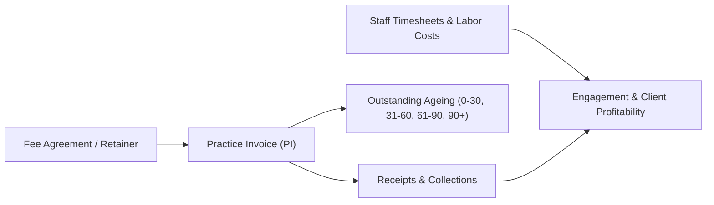

# PRACTICE FINANCE & PROFITABILITY SPECIFICATION

**Module:** Practice Revenue, Client Billing, Collections & Profitability  
**Status:** Implemented  
**Domain Integrity:** Strictly Isolated from Client Accounting Ledgers  

---

## 1. Practice Financial Domain

Chartered Accountants and accounting practices need to manage their own business revenue:

---

## 2. Core Practice Finance Records

1. **Practice Invoices (`practice_invoices`):**
   - Professional service billing to clients (GST compliant with CA firm GSTIN and SAC code 9982 / 9983).
   - Line items: Monthly Accounting, GSTR-3B filing, Tax Audit, Consultation.
   - Statuses: `DRAFT`, `ISSUED`, `PAID`, `PARTIAL`, `OVERDUE`, `CANCELLED`.
2. **Practice Receipts (`practice_receipts`):**
   - Payment logs linking client remittance (Bank Transfer, Cheque, UPI) to outstanding practice invoices.
   - Updates practice receivable ledger without touching the client's internal accounting books.
3. **Outstanding Fee Ageing:**
   - Real-time classification into 4 ageing buckets: `0-30 Days`, `31-60 Days`, `61-90 Days`, `90+ Days (Overdue)`.
   - Automated payment reminder templates for WhatsApp and email.
4. **Practice Profitability Analytics:**
   - Realized Revenue vs Direct Staff Labor Cost (hours logged * staff hourly cost).
   - Profit Margin % by Client, by Service Category (e.g. Audit vs GST), and by Responsible Partner.

