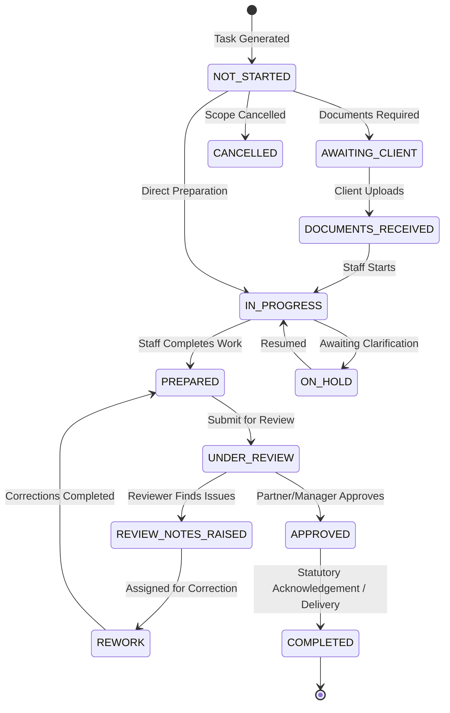

# TAXSHIELD PROFESSIONAL: SYSTEM & DOMAIN ARCHITECTURE SPECIFICATION

**System:** TaxShield Professional — Practice Management, Accounting & Compliance OS for India  
**Target Users:** Chartered Accountants, Tax Practitioners, Accounting Firms, and their Clients  
**Architecture Paradigm:** Hybrid Modular Monolith (FastAPI + Motor/MongoDB + Next.js App Router)  
**Security Standard:** Strict Tenant & Client Boundary Isolation, ICAI Professional Workflow Compliance  

---

## 1. High-Level System Architecture

TaxShield Professional connects two interdependent user experiences sharing a unified deterministic core:

```mermaid
graph TD
    subgraph TaxShieldProfessional["TAXSHIELD PROFESSIONAL (Firm Workspace)"]
        Dashboard["Practice Dashboard & Attention Center"]
        ClientMaster["Client Master & 360° Profile"]
        CRM["Leads & CRM Pipeline"]
        Engage["Engagement & Service Catalog"]
        Workflows["Recurring Compliance Engine"]
        Tasks["12-Status Task Management"]
        MakerChecker["Maker-Checker Review Queue"]
        Workpapers["Audit & Workpaper Desk (SA 230)"]
        TaxAudit["Tax Audit Workspace (Form 3CD)"]
        UDIN["UDIN Tracker & ICAI Verification"]
        GSTDesk["GST Practice Desk & 8-Way Recon"]
        TDSDesk["TDS Practice Desk & 24Q/26Q"]
        ITRDesk["Income Tax Desk & AIS/26AS"]
        FinDesk["Financial Statement Prep & TB Mapping"]
        PracticeFinance["Practice Fee Billing & Profitability"]
        NoticeDesk["Notice & Case Tracker"]
        Vault["Document Vault 2.0"]
        TeamWorkload["Staff Workload & Team Management"]
    end

    subgraph DeterministicCore["DETERMINISTIC KERNEL (Python 3.13)"]
        AccEngine["Double-Entry Accounting Engine"]
        TaxEngine["Old/New Regime & Capital Gains"]
        GSTEngine["GSTR-1, GSTR-3B & HSN Engine"]
        TDSEngine["TDS Deduction, Challan & Rates"]
        ReconEngine["Reconciliation & Discrepancy Classifier"]
        RuleRegistry["Source-Verified Versioned Rules"]
        AuditEngine["Tamper-Evident Audit Event Logger"]
    end

    subgraph TaxShieldClient["TAXSHIELD CLIENT (Client Portal 2.0)"]
        ClientDash["Client Executive Dashboard"]
        DocUpload["Document Request Uploads"]
        TaxSummary["Authorized Tax Summaries"]
        FeePay["Practice Invoices & Receipts"]
        MsgHub["Direct Accountant Communication"]
        TaskCheck["Assigned Client Actions"]
    end

    subgraph DataStore["PERSISTENCE & SECURITY"]
        MongoDB[("MongoDB 6+ Database")]
        SecureVault[("Secure File Storage Vault")]
        RBAC["Granular Role-Based Access Control"]
        SessionMgr["JWT with Token-Version Invalidation"]
    end

    TaxShieldProfessional --> DeterministicCore
    TaxShieldClient --> DeterministicCore
    DeterministicCore --> DataStore
```



---

## 2. Core Entities & Data Model

### A. Practice Profile (`practice_profiles`)
```json
{
  "_id": "ObjectId",
  "user_id": "ObjectId",
  "firm_name": "Kailash & Associates, Chartered Accountants",
  "firm_type": "partnership",
  "icai_frn": "012345S",
  "primary_contact_name": "CA Kailash Nath",
  "email": "kailash@kailashca.in",
  "phone": "+91 9876543210",
  "address": "42, MG Road, Fort, Mumbai 400001",
  "branches": [
    {"name": "Head Office", "city": "Mumbai", "is_head_office": true},
    {"name": "Branch Office", "city": "Pune", "is_head_office": false}
  ],
  "partners": [
    {"name": "CA Kailash Nath", "membership_number": "123456", "cop_status": "active"},
    {"name": "CA Sunita Sharma", "membership_number": "654321", "cop_status": "active"}
  ],
  "departments": ["Audit & Assurance", "Direct Tax", "Indirect Tax (GST)", "Accounting"],
  "services": ["Monthly Accounting", "GSTR-1 & 3B", "TDS 26Q/24Q", "ITR Filing", "Tax Audit 44AB"],
  "created_at": "ISODate"
}
```

### B. Client Master (`clients`)
```json
{
  "_id": "ObjectId",
  "user_id": "ObjectId",
  "client_code": "CLT-00104",
  "name": "Acme Industrial Technologies Pvt Ltd",
  "entity_type": "pvt_ltd",
  "pan": "ABCDE1234F",
  "tan": "MUMB12345A",
  "gstin": "27ABCDE1234F1Z5",
  "cin_llpin": "U72200MH2020PTC123456",
  "email": "accounts@acmeind.com",
  "phone": "+91 9820011223",
  "address": "Plot 12, MIDC, Andheri East, Mumbai 400093",
  "business_activity": "Manufacturing & Software",
  "financial_year": "2024-25",
  "gst_frequency": "monthly",
  "tds_applicable": true,
  "tax_audit_applicable": true,
  "responsible_partner": "CA Kailash Nath",
  "assigned_accountant": "Rahul Verma",
  "client_group_id": "GRP-001",
  "tags": ["High Priority", "GST Monthly", "Audit Applicable", "Manufacturing"],
  "risk_score": 18,
  "status": "active",
  "created_at": "ISODate"
}
```

### C. Engagements (`engagements`)
```json
{
  "_id": "ObjectId",
  "user_id": "ObjectId",
  "engagement_code": "ENG-2024-0042",
  "client_id": "ObjectId",
  "client_name": "Acme Industrial Technologies Pvt Ltd",
  "service_category": "gst",
  "service_name": "Monthly GST Compliance & Reconciliation",
  "scope": "Monthly GSTR-1, GSTR-3B, GSTR-2B reconciliation, ITC optimization",
  "period": "2024-25",
  "start_date": "2024-04-01",
  "end_date": "2025-03-31",
  "fee_type": "recurring_monthly",
  "agreed_fee": 15000,
  "responsible_partner": "CA Kailash Nath",
  "assigned_staff": "Rahul Verma",
  "reviewer": "Pooja Desai",
  "status": "in_progress",
  "created_at": "ISODate"
}
```

### D. Professional Tasks (`tasks`)
```json
{
  "_id": "ObjectId",
  "user_id": "ObjectId",
  "task_code": "TSK-0841",
  "title": "GSTR-3B Preparation & ITC Review - October 2024",
  "client_id": "ObjectId",
  "client_name": "Acme Industrial Technologies Pvt Ltd",
  "engagement_id": "ObjectId",
  "service_category": "gst",
  "period": "2024-10",
  "due_date": "2024-11-20",
  "priority": "high",
  "assigned_to": "Rahul Verma",
  "reviewer": "CA Kailash Nath",
  "status": "UNDER_REVIEW",
  "checklist": [
    {"item": "Import Sales Register from Tally", "done": true},
    {"item": "Import Purchase Register", "done": true},
    {"item": "Download GSTR-2B JSON", "done": true},
    {"item": "Run 8-way ITC reconciliation", "done": true},
    {"item": "Identify blocked ITC under Sec 17(5)", "done": true},
    {"item": "Draft GSTR-3B tax payment summary", "done": true},
    {"item": "Partner Review & Approval", "done": false}
  ],
  "estimated_hours": 4.5,
  "actual_hours": 4.0,
  "history": [
    {"status": "NOT_STARTED", "changed_at": "2024-11-01T09:00:00Z", "changed_by": "System"},
    {"status": "IN_PROGRESS", "changed_at": "2024-11-05T10:15:00Z", "changed_by": "Rahul Verma"},
    {"status": "PREPARED", "changed_at": "2024-11-10T16:30:00Z", "changed_by": "Rahul Verma"},
    {"status": "UNDER_REVIEW", "changed_at": "2024-11-10T16:31:00Z", "changed_by": "Rahul Verma"}
  ],
  "created_at": "ISODate"
}
```

---

## 3. Maker-Checker Review Workflow & ICAI Quality Standards

Under ICAI Statement on Quality Control (SQC-1), work performed by engagement team members must be independently reviewed prior to signing and statutory submission.



### Self-Approval Prevention Rule
When a task has an assigned reviewer different from the assignee, or firm policy requires independent sign-off, the preparing staff member cannot approve their own work. The backend raises HTTP 403 Forbidden:
`"Independent review required: preparer cannot approve work under firm quality control policy."`

---

## 4. Practice Finance vs Client Accounting Boundary

A foundational architectural principle of TaxShield is the strict separation between:

1. **Client Accounting Domain:**
   - Double-entry journals, sales, purchases, bank accounts, balance sheets belonging to the client's business.
   - Handled in `backend/app/accounting.py` and `journals` collection.
2. **Practice Revenue Domain:**
   - Professional fees billed by the CA firm to the client for accounting, audit, tax, and consulting services.
   - Handled in `practice_invoices`, `practice_receipts`, and `fee_agreements`.
   - Never creates journals in the client's books.

3. **TaxShield SaaS Subscription Domain:**
   - Subscription fees paid by the CA firm to TaxShield for software usage.
   - Handled in `commerce.py` and `commerce_api.py`.

These three financial layers are physically isolated and never intersect or contaminate each other's ledgers.

